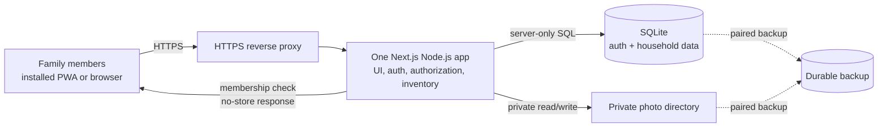

# HomeFind v1 architecture

**Status:** Proposed for review
**Updated:** 2026-10-16
**Product spec:** [`../specs/2026-10-15-homefind-design.md`](../specs/2026-10-15-homefind-design.md)

## Architecture at a glance

Use a single Next.js App Router application running as one Node.js process on the family’s server. The app owns the UI, authentication integration, household authorization, inventory operations, and private photo delivery. SQLite and the private photo directory share one durable local data volume.

This keeps the first release small and fits one household. It also creates a deliberate deployment boundary: one app instance, one server-local SQLite database, and no serverless or network-mounted database.

## Components and boundaries

### Next.js application

- App Router pages render the Search, Add, and item-detail experiences.
- Client-side behavior is limited to live search, photo selection, and the expandable location tree.
- Server-only modules own database access, authentication checks, inventory operations, location operations, invitation operations, and file storage.
- Use route handlers for authentication and multipart photo submission/private photo delivery. Use server actions or route handlers for other validated mutations, following one consistent pattern during implementation.
- Run Node.js runtime; do not route SQLite work through Edge or serverless functions.

### Authentication and household authorization

- Use a maintained auth library with its SQLite adapter; the existing implementation proposal is Better Auth with email/password and `better-sqlite3`.
- Keep the auth tables and app tables in the same SQLite database if supported by the selected library version.
- `requireMember` resolves the signed-in user's household membership before any inventory, location, or photo operation. `requireOwner` protects invitation management and initial household setup.
- A household membership row carries `owner` or `member` role. All members can add, read, update, move, and delete items; only owners manage invitations.
- Initial owner setup is one-time. Invitations use random tokens, store only token hashes, expire after seven days, and are consumed once when membership is created.
- Password-recovery email is unresolved: decide whether to configure SMTP or defer self-service reset before implementation.

### SQLite data

Keep one SQLite file under a configurable data directory such as `HOMEFIND_DATA_DIR`. Enable foreign-key enforcement and use transactions for multi-row changes.

App-owned tables:

- `household` — the one home in v1.
- `membership` — user, household, and owner/member role.
- `location` — household-scoped nodes with `parent_id` for the hierarchy.
- `item` — name, optional notes, one location, private photo path, creator, and timestamps.
- `invitation` — household, inviter, hashed token, expiry, and used timestamp.

Keep household IDs on item and location records so reads and writes can be scoped explicitly. Add indexes for household membership, location parents, and item names. Use a case-insensitive partial-name query for Search; do not search notes or location names in v1.

### Private photo storage

Store photos under `HOMEFIND_DATA_DIR/uploads`, outside `public/`. Generate storage names on the server; store only relative paths in SQLite. Validate actual image content and a bounded upload size, then normalize supported formats during implementation. Never serve the upload directory statically.

Serve a photo by item ID. The handler loads the item under the current member's household, then reads its server-owned photo path and returns a private, non-cacheable response. A request for another household's item must reveal neither item data nor photo bytes.

### PWA and caching

Provide a web app manifest and install icons. Treat item pages, API responses, and photos as private dynamic data. Do not cache them in a service worker or shared cache. The app is online-first; the service worker must not imply offline inventory access.

## Data flows

### Add an item

1. The member selects Camera or Photo Library, enters a name, selects or creates a location, and optionally opens **Add note**.
2. The server verifies the session and household membership, validates required fields and image content/size, and chooses a generated filename.
3. The server writes the private photo and inserts the item record in a database transaction.
4. If a caught database or file operation fails, roll back the record where applicable, remove any newly written photo, and return a retryable error. Return success only when both are saved.

SQLite and filesystem writes cannot share one atomic transaction. A process crash between file creation and database commit can leave an unreferenced private photo; it is not exposed through item routes. The first implementation should document this recovery limit and avoid claiming crash-atomic cleanup.

### Search and location selection

- Search sends the current query to a server-side household-scoped query and updates results while typing.
- The location tree is loaded for the current household. Selecting a row assigns that node; the chevron only expands or collapses children.
- Adding a location creates one child under the current parent and selects it immediately. At the root, the same action creates a top-level location.

### Move and delete

- Move changes the item's location through the same membership and household checks as other item updates.
- Delete requires a confirmation in the UI, then deletes the item record and its photo. File cleanup failures must be logged and must not make a deleted item's photo retrievable through the application.

## Deployment and data protection

- Run one Node.js app container or process behind an HTTPS reverse proxy.
- Mount one durable local directory at `/data` (or configure another local path) for the SQLite database and uploads.
- Do not run multiple writers on separate SQLite files or put the SQLite file on network storage.
- Back up the SQLite database and upload directory as one recovery set. Stop the app for a straightforward consistent filesystem copy, or use a SQLite-aware backup procedure while coordinating the photo directory. Restore both before restarting the app.
- Keep setup tokens, auth secrets, and base URL in server-side environment configuration; never expose them to browser bundles.

## Main trade-offs

- **Chosen:** one Next.js server with local SQLite and local private files. It has fewer services and straightforward local backups for a single household.
- **Not chosen:** a separate API service and database server. That adds deployment and operational overhead without a current multi-home or multi-server requirement.
- **Not chosen:** object storage for photos. That adds external credentials and another backup/access-control boundary while the app is explicitly self-hosted on one server.

The limits are intentional: SQLite is tied to one server and one app instance, and remote access depends on that server and its HTTPS entry point. Revisit the storage and database boundary if multi-server operation, higher write concurrency, or external storage becomes a real requirement.

## Open decisions for implementation planning

- Confirm Better Auth adapter behavior and migration workflow against the selected package versions.
- Decide SMTP-based password recovery versus deferring recovery in v1.
- Choose the supported input image formats and maximum upload size based on current iOS Safari and Android Chrome behavior.
- Define the exact production backup command and verify a restore of both SQLite and photos.
